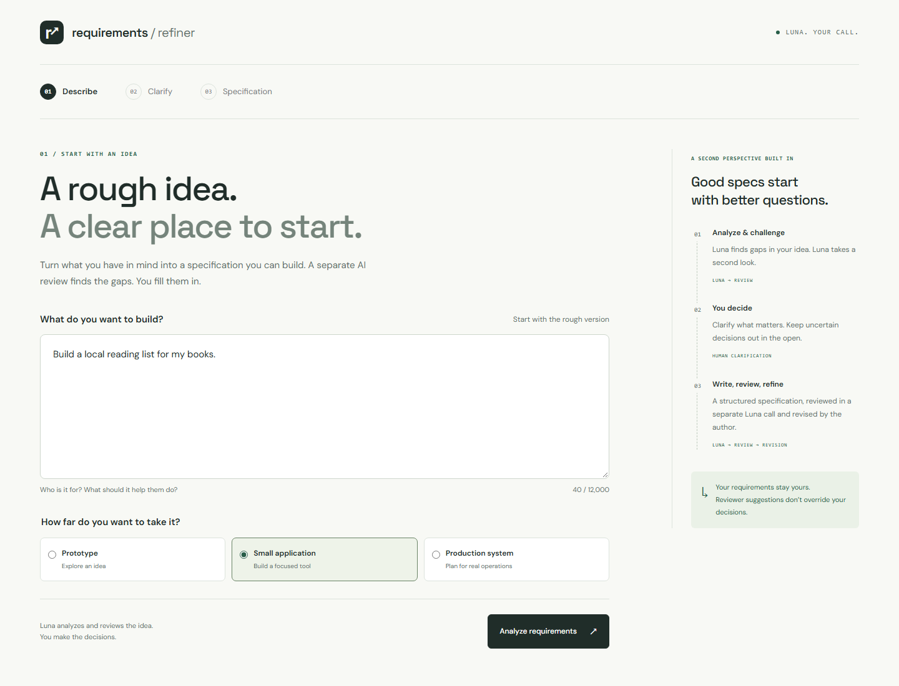
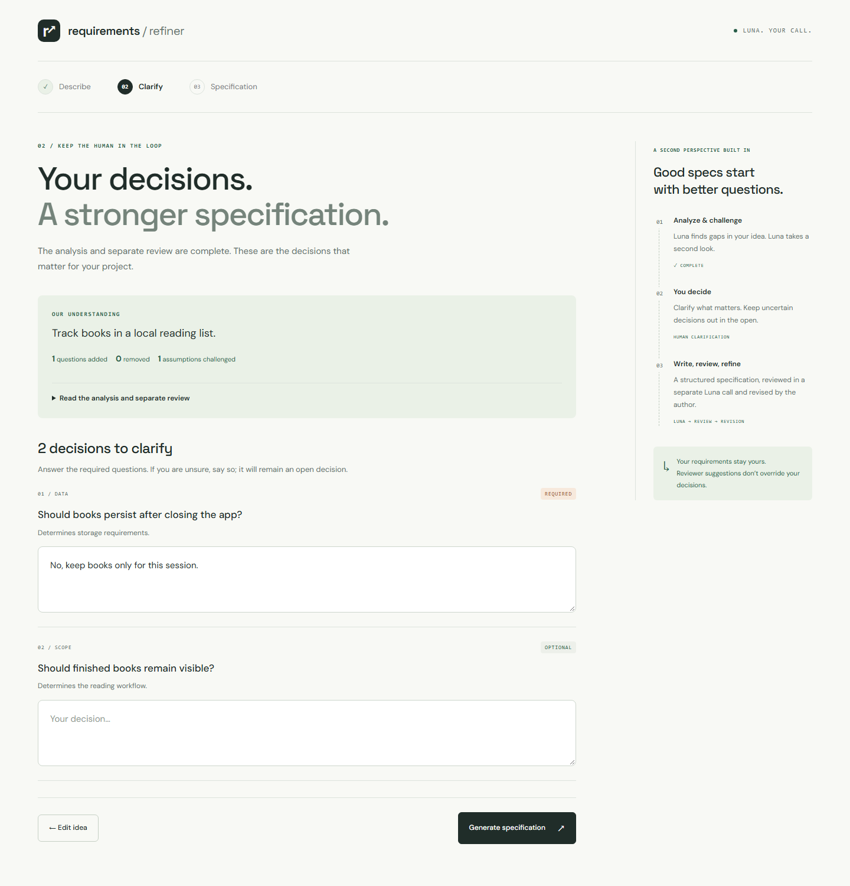
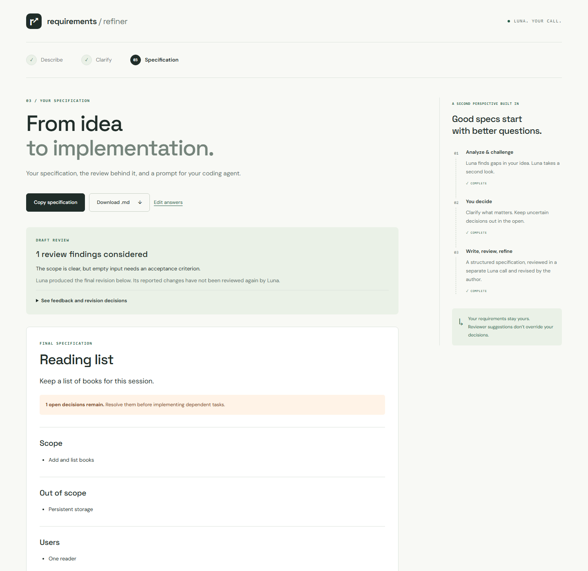

# Requirements Refiner

Turn a rough project idea into a specification you can build.

Requirements Refiner helps developers clarify scope before writing code. It analyzes an idea, challenges the analysis in a separate AI review, and asks you to make the decisions. The result is a structured specification with acceptance criteria, implementation tasks, and a prompt for your coding agent.

**Describe your idea. Clarify the gaps. Export your plan.**



**Live demo:** [ai-requirements-refiner.vercel.app](https://ai-requirements-refiner.vercel.app)

[Try it](#try-it) · [Get started](#run-locally) · [See the workflow](#workflow) · [Explore the code](#code-organization) · [Deployment & operations](#deployment--operations) · [Run the checks](#validation)

## Try it

The public deployment opens in **demo mode**. Pick one of three recorded examples (a community-garden shift sign-up, a personal reading list, a payment webhook relay) and walk through the complete flow: analysis, reviewed questions, draft review, final specification, and export. Demo mode makes no model call, costs nothing, and every screen is labelled **Recorded example**.

**Live mode** runs your own idea through `gpt-5.6-luna`, five calls per full run:

- With the hosted key, each visitor gets a few free runs per day (3 by default) under a shared daily cap. When either limit is reached, the app explains why and switches back to the recorded examples.
- With **your own OpenAI API key**, the hosted quota does not apply and usage is billed to your account. The key is sent only in a request header to this app's server for that request. It is never stored, logged, or returned, and it is never exposed through a `NEXT_PUBLIC_` variable.

## What you get

- Questions reviewed before you answer them, with required and optional decisions clearly marked.
- A specification covering scope, requirements, acceptance criteria, edge cases, and implementation tasks.
- Traceability between requirements, acceptance criteria, and tasks, with checks for broken references and circular dependencies.
- Visible draft feedback and a record of which suggestions the final revision applied, rejected, or deferred.
- Markdown download, specification copying, and a separate coding-agent prompt.
- Recoverable errors that keep your input and answers available for retry.

Built with Next.js, React, TypeScript, Zod, and the OpenAI SDK. The author and reviewer use the same Luna model in separate calls.

## A look inside

The screenshots show the actual application with the reading-list example. The clarification and specification screens use the same recorded data as demo mode ([`lib/demo/examples`](lib/demo/examples)), not live model responses.

<details>
<summary>Clarify the decisions behind your idea</summary>

The review challenges an assumption about persistent storage and adds a question about finished books. You decide what belongs in scope, and unanswered optional questions remain open.



</details>

<details>
<summary>Inspect the review and export your specification</summary>

The result keeps the draft review alongside the final specification. Open decisions stay visible, and you can copy the specification or download it as Markdown.



</details>

## Run locally

Requires Node.js 22.12 or newer and npm. An OpenAI API key is needed only for live runs.

1. Run `npm ci`.
2. Copy `.env.example` to `.env.local`.
3. Optional: set `OPENAI_API_KEY` in `.env.local` for live runs with the hosted key.
4. Run `npm run dev` and open [localhost:3000](http://localhost:3000).

All analysis, drafting, review, and revision calls use `gpt-5.6-luna`. Restart the server after changing environment variables. Never prefix API keys with `NEXT_PUBLIC_` or commit `.env.local`.

The UI, the recorded examples, and the automated tests run without credentials. Recorded output is shown only when you choose a recorded example, or after a live request is refused, and it is always labelled. It is never passed off as live output. Locally, the daily quota uses an in-memory counter that resets when the server restarts. Upstash is needed only on Vercel.

If you use `.env` instead of `.env.local`, remove duplicate settings from `.env.local`. Next.js gives `.env.local` higher priority, even when its API key entries are blank.

For a production build, run `npm run build`, then `npm start`. Before exposing a server publicly, read [Deployment & operations](#deployment--operations). The paid routes are protected by a kill switch, bot verification, and per-visitor and global daily limits, and those controls assume the Vercel setup described there.

## Workflow

```text
Idea + project complexity
  → Luna requirements analysis
  → Luna requirements critique
  → Human answers to the reviewed questions
  → Luna draft specification
  → Luna specification review
  → Luna final revision
  → Deterministic Markdown + coding-agent prompt
```

Only Luna's final question list appears in the clarification form. Required questions need a nonblank answer; an explicit "undecided" answer is allowed and must remain an unresolved decision. Recommended and optional questions can be skipped. A sufficiently detailed idea may produce no questions.

The result includes the final specification, original draft, Luna's draft review, and the editor's reported disposition for every review issue. These dispositions are not a second review. The UI never claims Luna verified the final revision. Open decisions and unconfirmed assumptions remain visible and appear in the Markdown export.

The finalization prompt ranks explicit user statements and clarification answers above model conclusions and reviewer recommendations. This is a behavioral model constraint, not a guarantee of semantic correctness. Review the output before handing it to a coding agent.

## Code organization

- `app/api/analyze/route.ts` and `app/api/specification/route.ts` validate requests and invoke the pipelines through `lib/access`.
- `lib/access` decides how each request runs: recorded example, the kill switch, Vercel BotID, the visitor's own key, or the hosted key under the daily quota (`QuotaStore` with Upstash and in-memory implementations).
- `lib/demo` holds the recorded examples. Tests replay each one through the real orchestration, so recordings pass the same validation as live output.
- `lib/orchestration` owns call order, stage failures, and validation between stages.
- `lib/llm` contains the small `StructuredLLM` interface and a server-only OpenAI SDK adapter using Responses structured output with `store: false`.
- `lib/schemas` defines Zod contracts and integrity checks for unique IDs, acceptance criteria, task coverage, and acyclic dependencies.
- `prompts/*.md` contains the five task-specific prompts. `lib/prompts/loader.ts` reads only known prompt names. Next.js file tracing includes these files in the API routes.
- `components` contains the guided forms, analysis summary, review details, and specification view.
- `lib/markdown.ts` renders all sections deterministically. It escapes prose and preserves the separate coding-agent prompt verbatim in a safe code fence.

Tasks add `requirementIds` to the plan's example schema to make coverage checkable. Finalization adds `reviewDecisions` to report applied, rejected, and deferred suggestions. Error state is kept alongside the current form so input remains editable and recoverable.

## API

Both routes accept `mode: "demo" | "live"` (default `"demo"`) and, in demo mode, an `exampleId`. Successful responses carry `source: "recorded" | "live"`. A visitor's own key goes in the `X-OpenAI-Key` header, never in the body.

`POST /api/analyze` takes `{ description, complexity }`, where complexity is `prototype`, `small_application`, or `production_system`. It returns `{ analysis, review, questions }`.

`POST /api/specification` takes `{ description, complexity, analysis, questions, answers }`, with answers keyed by question ID. It returns `{ draft, review, finalSpecification, reviewDecisions }`.

Requests must be JSON and are bounded to 512,000 bytes. Descriptions allow 10–12,000 characters; answers allow up to 6,000 each. Error responses contain `error` and, for pipeline failures, `stage`. Invalid input returns 400, oversized input 413, missing configuration 503, provider rate limits 429, and other provider or structured-output failures 502 or 504. Refusals before any paid call carry a `code` and, where a recorded example can stand in, `fallback: "demo"`: `live_quota_exceeded` (429, with `Retry-After`), `live_disabled` and `live_unavailable` (503), `bot_detected` (403), `verification_unavailable` (503), and `invalid_api_key_format` (400). Input limits apply in every mode, including runs with the visitor's own key.

Each provider call has a 90-second timeout. The client allows five minutes per pipeline request. A failed review stops the pipeline. Retry reruns the current pipeline from its beginning, so successful earlier calls can incur another charge. There are no hidden fallback providers, background jobs, or automatic unreviewed results.

## Data handling

The application keeps state only in React memory. Refreshing or closing the tab clears it. There is no database, account system, project history, local storage, or file upload. Export before leaving. Project descriptions, answers, and intermediate outputs are transmitted server-side to OpenAI for processing; provider retention policies still apply. Responses are generated with `store: false`. For the daily quota, Redis stores only counters keyed by a SHA-256 hash of the visitor's IP address, never the address itself, and they expire with the daily window. A visitor's own API key is used only for that request and is not logged, stored, or echoed in errors. Application errors do not return raw provider messages, keys, or submitted project data. Fonts are loaded from Google Fonts, with local fallback fonts if unavailable.

## Deployment & operations

Step-by-step setup: [docs/DEPLOYMENT.md](docs/DEPLOYMENT.md).

**Hosting.** Vercel, with the repository connected for automatic deployments. Both API routes run on the Node.js runtime with `maxDuration = 300` s, enough for three 90-second calls.

**Environment variables** (all server-side; see [`.env.example`](.env.example)):

| Variable | Purpose | Default |
| --- | --- | --- |
| `DEMO_ONLY` | Kill switch. Anything except `false`/`0`/`no`/`off` disables every paid call, including visitor keys. | off |
| `OPENAI_API_KEY` | Hosted key for free live runs. Leave empty to offer only demo mode and the visitor's own key. | none |
| `UPSTASH_REDIS_REST_URL`, `UPSTASH_REDIS_REST_TOKEN` | Shared daily counters. `KV_REST_API_URL`/`KV_REST_API_TOKEN` also work. Required for hosted live runs on Vercel. | none |
| `LIVE_RUNS_PER_IP_PER_DAY` | Free runs per visitor IP per day. | 3 |
| `LIVE_RUNS_GLOBAL_PER_DAY` | Free runs for all visitors per day. | 30 |

**Rate limits.** Fixed daily windows reset at 00:00 UTC. A full run is one analysis and one specification request, and each route has its own counter, so at most `LIVE_RUNS_GLOBAL_PER_DAY` × 5 hosted OpenAI calls happen per day (150 with the defaults). The visitor counter is checked before the global one. Invalid input and failed bot checks consume nothing.

**Fail closed.** Hosted live runs stay off when there is no Upstash on Vercel (in-memory counters would not be shared across instances), when Redis errors or times out (`@upstash/ratelimit` would otherwise let requests through after its timeout), or when BotID cannot verify a request.

**Bot protection.** [Vercel BotID](https://vercel.com/docs/botid) attaches an invisible challenge to `POST /api/analyze` and `POST /api/specification` (`instrumentation-client.ts`), and the server calls `checkBotId()` before any paid call, including those with a visitor's key. Demo requests skip the check because they cost nothing.

**Budget cap.** Code limits are not a billing guarantee. Use a dedicated OpenAI project for the hosted key, set a monthly budget (for example $5) with an email alert, and prefer prepaid credits with auto-recharge off. See the [deployment checklist](docs/DEPLOYMENT.md#3-cap-spending-in-openai).

**Kill switch.** Set `DEMO_ONLY=true` in Vercel and redeploy. Vercel applies changed variables only to new deployments. Live mode then appears disabled, and the API refuses live requests with 503.

**When limits are hit.** The visitor sees a plain message ("You have used today's 3 free live runs…"). At the idea step the app switches to the recorded examples and keeps their typed idea for later. Mid-run, it keeps their answers and offers a recorded example or their own key.

**Known limitations.**

- IP-based limits are approximate. Visitors behind one NAT share a counter, and someone rotating addresses can get more runs. The global cap and the OpenAI budget are the real cost bounds.
- Retries count as new runs, and provider failures still consume the run.
- BotID works only on Vercel. Local and self-hosted servers have no bot check.
- A visitor's key passes through this server for that request, so visitors must trust the deployment. Recommend a restricted, low-budget key.
- The recorded examples were written against the pipeline's schemas and pass its validators, but they were not captured from a live model run.
- There are no accounts and no stored history. Visitors must export before leaving.

## Validation

```sh
npm run lint
npm run typecheck
npm test
npm run build
npm run test:e2e   # after the build; first run: npx playwright install chromium
```

GitHub Actions ([`.github/workflows/ci.yml`](.github/workflows/ci.yml)) runs all five steps on every push to `main` and on every pull request, without secrets.

Tests cover request/schema validation, reference integrity, deterministic Markdown, real prompt loading, mocked SDK adapters, orchestration order and review forwarding, failure handling, the React workflow including retry and clipboard actions, demo-mode routing, the kill switch, the rate limiter with a mocked store (including Upstash's fail-open timeout), bot-check failures, the 429 fallback, and proof that a visitor's key is never logged or returned. Every recorded example is replayed through the real pipeline validation. A Playwright test completes the full flow in demo mode against a production build with `DEMO_ONLY=true`. No test calls a paid API.

To verify live integration after configuring keys, submit a small idea such as "A local reading list for my books," answer the reviewed questions, and generate a specification. Check Luna's review details and export both the Markdown and agent prompt. A full successful run makes five OpenAI calls using Luna. On 2026-11-24, live mode was verified end to end on the production deployment when a full run with `gpt-5.6-luna` (analysis, critique, draft, review, and final revision) passed bot verification and the daily quota check and returned a complete specification.

API implementation reference: [OpenAI structured outputs](https://developers.openai.com/api/docs/guides/structured-outputs). Model reference: [GPT-5.6 Luna](https://developers.openai.com/api/docs/models/gpt-5.6-luna).

## API troubleshooting

<details>
<summary>Diagnose configuration, provider, and pipeline errors</summary>

Errors show the failing stage, configured model, upstream HTTP status, a recognized provider error code, and a request ID. Match that ID to `[refiner:api]` entries in the terminal running `npm run dev`. `[refiner:stage]` entries show when each stage starts, completes, or fails, with elapsed time. Logs exclude keys, request/response bodies, and raw SDK errors.

- `missing_configuration`: the message lists the missing variables. Check `.env.local` overrides and restart the server.
- `credit_balance_exhausted` or `insufficient_quota`: check the API account's billing, credits, and project budget. This is not a temporary rate limit; retrying alone cannot fix it.
- `rate_limit_exceeded`: wait, then retry.
- `model_not_found`: verify the model ID and the API project's access to it.
- `invalid_json_schema`: the provider rejected the output schema. Use the failing stage to identify the schema.
- Upstream HTTP 503: the provider is temporarily unavailable or overloaded.

For OpenAI billing, check [API billing](https://platform.openai.com/settings/organization/billing/overview). API usage is billed separately from a ChatGPT subscription.

</details>
