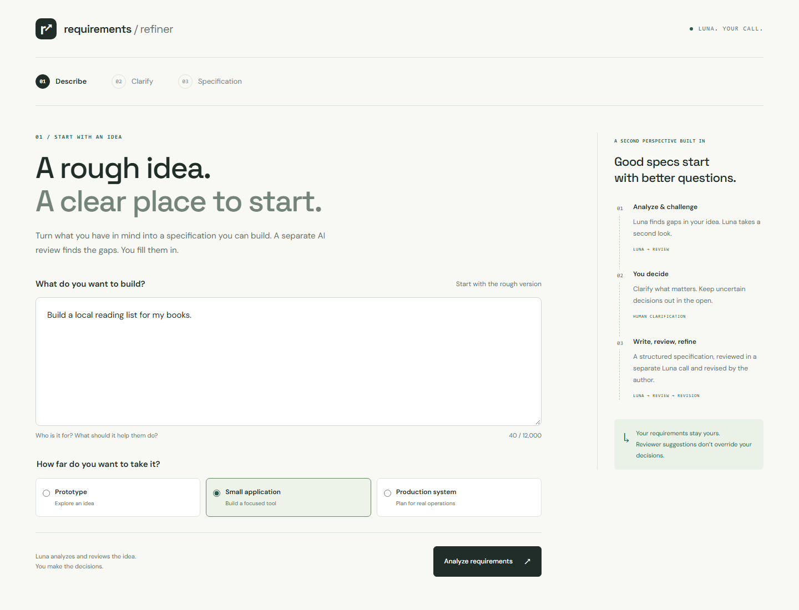
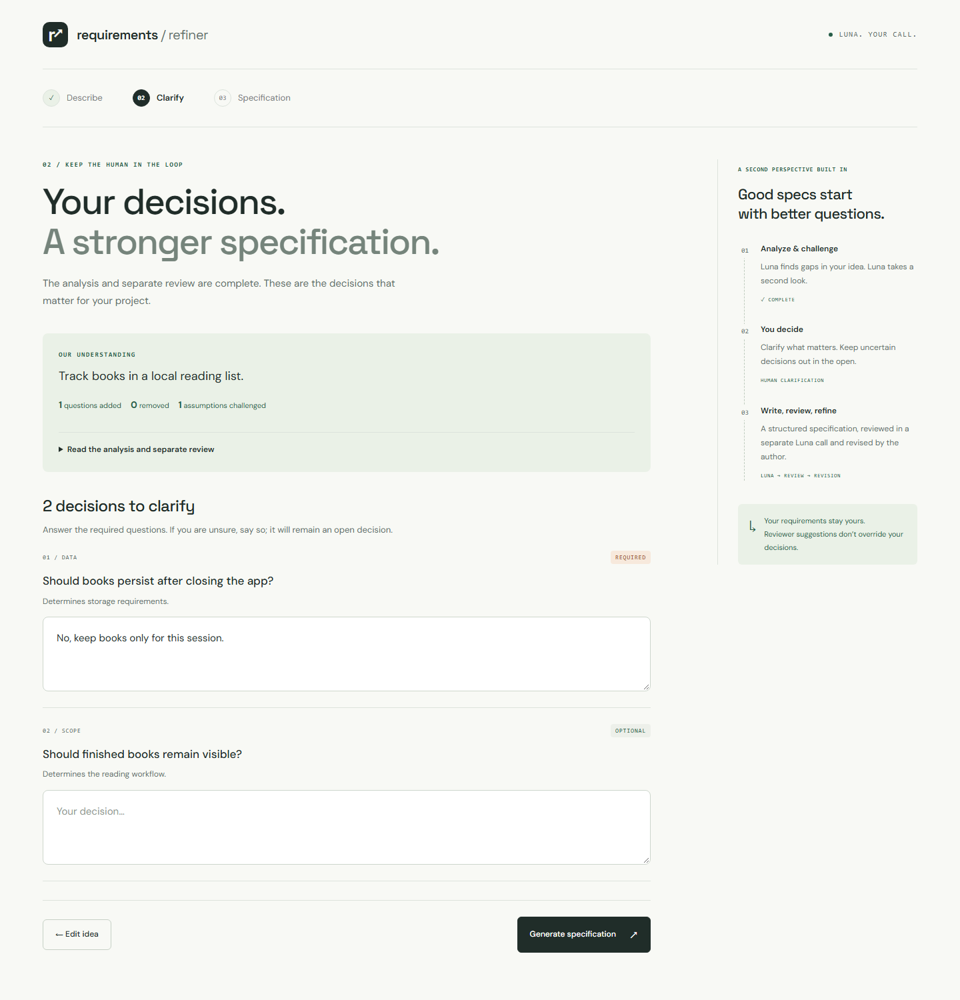
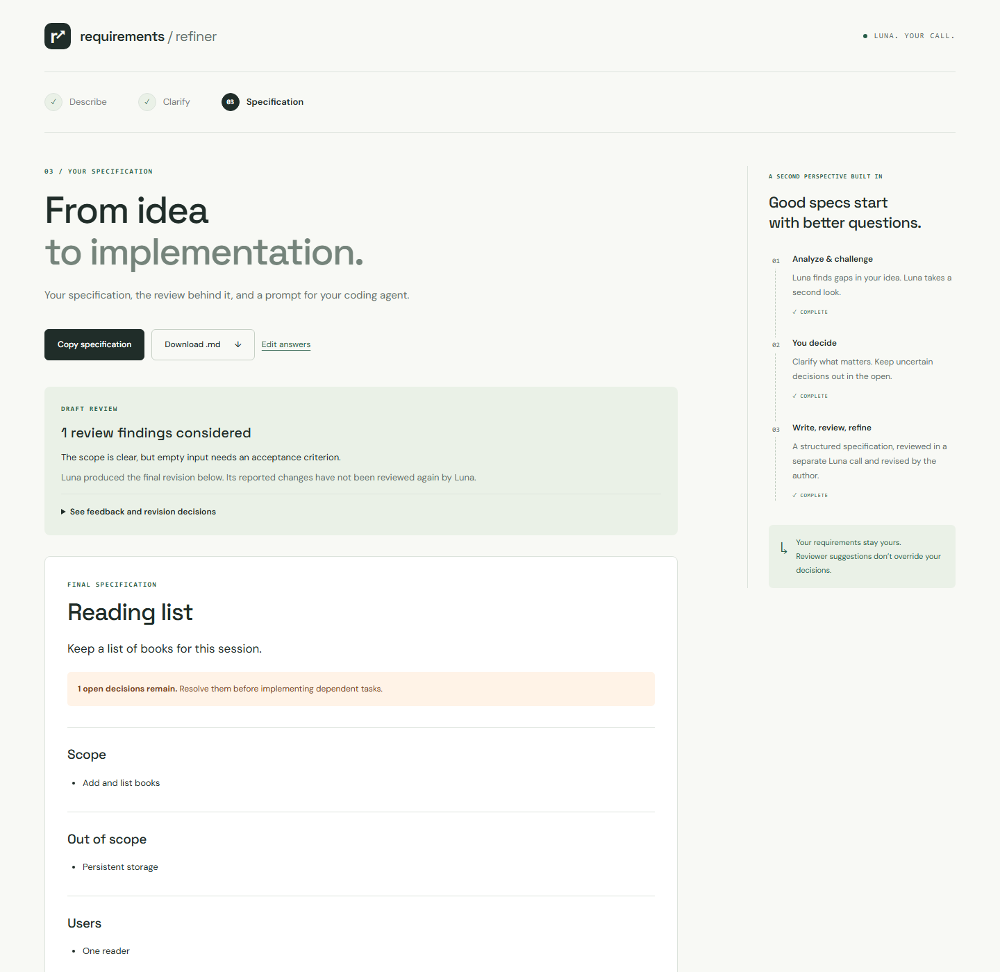

# Requirements Refiner

Turn a rough project idea into a specification you can build.

Requirements Refiner helps developers clarify scope before writing code. It analyzes an idea, challenges the analysis in a separate AI review, and asks you to make the decisions. The result is a structured specification with acceptance criteria, implementation tasks, and a prompt for your coding agent.

**Describe your idea. Clarify the gaps. Export your plan.**



[Get started](#run-locally) · [See the workflow](#workflow) · [Explore the code](#code-organization) · [Run the checks](#validation)

## What you get

- Questions reviewed before you answer them, with required and optional decisions clearly marked.
- A specification covering scope, requirements, acceptance criteria, edge cases, and implementation tasks.
- Traceability between requirements, acceptance criteria, and tasks, with checks for broken references and circular dependencies.
- Visible draft feedback and a record of which suggestions the final revision applied, rejected, or deferred.
- Markdown download, specification copying, and a separate coding-agent prompt.
- Recoverable errors that keep your input and answers available for retry.

Built with Next.js, React, TypeScript, Zod, and the OpenAI SDK. The author and reviewer use the same Luna model in separate calls.

## A look inside

The screenshots show the actual application with a reading-list example. The clarification and specification screens use [test fixtures](tests/fixtures.ts), rather than live model responses. No API credentials are needed to reproduce these example outputs in tests; the application itself requires a key for generation.

<details>
<summary>Clarify the decisions behind your idea</summary>

The review challenges an assumption about persistent storage and adds a question about finished books. You decide what belongs in scope, and unanswered optional questions remain open.



</details>

<details>
<summary>Inspect the review and export your specification</summary>

The result keeps the draft review alongside the final specification. Open decisions stay visible, and you can copy the specification or download it as Markdown.



</details>

## Run locally

Requires Node.js 22.12 or newer, npm, an OpenAI API key.

1. Run `npm ci`.
2. Copy `.env.example` to `.env.local`.
3. Set `OPENAI_API_KEY` in `.env.local`.
4. Run `npm run dev` and open [localhost:3000](http://localhost:3000).

All analysis, drafting, review, and revision calls use `gpt-5.6-luna`. Restart the server after changing environment variables. Never prefix API keys with `NEXT_PUBLIC_` or commit `.env.local`.

The UI and automated tests run without credentials. Generating real analyses and specifications requires an OpenAI API key. No demo responses are substituted when credentials are missing.

If you use `.env` instead of `.env.local`, remove duplicate settings from `.env.local`. Next.js gives `.env.local` higher priority, even when its API key entries are blank.

For a production build, run `npm run build`, then `npm start`. V1 is intended for local use. Its paid API routes have no authentication or application rate limiter; do not expose the server publicly without adding those controls.

## Workflow

```text
Idea + project complexity
  → Luna requirements analysis
  → Luna requirements critique
  → Human answers to the reviewed questions
  → Luna draft specification
  → Luna specification review
  → Luna final revision
  → Deterministic Markdown + coding-agent prompt
```

Only Luna's final question list appears in the clarification form. Required questions need a nonblank answer; an explicit "undecided" answer is allowed and must remain an unresolved decision. Recommended and optional questions can be skipped. A sufficiently detailed idea may produce no questions.

The result includes the final specification, original draft, Luna's draft review, and the editor's reported disposition for every review issue. These dispositions are not a second review. The UI never claims Luna verified the final revision. Open decisions and unconfirmed assumptions remain visible and appear in the Markdown export.

The finalization prompt ranks explicit user statements and clarification answers above model conclusions and reviewer recommendations. This is a behavioral model constraint, not a guarantee of semantic correctness. Review the output before handing it to a coding agent.

## Code organization

- `app/api/analyze/route.ts` and `app/api/specification/route.ts` validate requests and invoke the pipelines.
- `lib/orchestration` owns call order, stage failures, and validation between stages.
- `lib/llm` contains the small `StructuredLLM` interface and a server-only OpenAI SDK adapter using Responses structured output with `store: false`.
- `lib/schemas` defines Zod contracts and integrity checks for unique IDs, acceptance criteria, task coverage, and acyclic dependencies.
- `prompts/*.md` contains the five task-specific prompts. `lib/prompts/loader.ts` reads only known prompt names. Next.js file tracing includes these files in the API routes.
- `components` contains the guided forms, analysis summary, review details, and specification view.
- `lib/markdown.ts` renders all sections deterministically. It escapes prose and preserves the separate coding-agent prompt verbatim in a safe code fence.

Tasks add `requirementIds` to the plan's example schema to make coverage checkable. Finalization adds `reviewDecisions` to report applied, rejected, and deferred suggestions. Error state is kept alongside the current form so input remains editable and recoverable.

## API

`POST /api/analyze` takes `{ description, complexity }`, where complexity is `prototype`, `small_application`, or `production_system`. It returns `{ analysis, review, questions }`.

`POST /api/specification` takes `{ description, complexity, analysis, questions, answers }`, with answers keyed by question ID. It returns `{ draft, review, finalSpecification, reviewDecisions }`.

Requests must be JSON and are bounded to 512,000 bytes. Descriptions allow 10–12,000 characters; answers allow up to 6,000 each. Error responses contain `error` and, for pipeline failures, `stage`. Invalid input returns 400, oversized input 413, missing configuration 503, provider rate limits 429, and other provider or structured-output failures 502 or 504.

Each provider call has a 90-second timeout. The client allows five minutes per pipeline request. A failed review stops the pipeline. Retry reruns the current pipeline from its beginning, so successful earlier calls can incur another charge. There are no hidden fallback providers, background jobs, or automatic unreviewed results.

## Data handling

The application keeps state only in React memory. Refreshing or closing the tab clears it. There is no database, account system, project history, local storage, or file upload. Export before leaving. Project descriptions, answers, and intermediate outputs are transmitted server-side to OpenAI for processing; provider retention policies still apply. Application errors do not return raw provider messages, keys, or submitted project data. Fonts are loaded from Google Fonts, with local fallback fonts if unavailable.

## Validation

```sh
npm run lint
npm run typecheck
npm test
npm run build
```

Tests cover request/schema validation, reference integrity, deterministic Markdown, real prompt loading, mocked SDK adapters, orchestration order and review forwarding, failure handling, and the React workflow including retry and clipboard actions. They do not call paid APIs.

To verify live integration after configuring keys, submit a small idea such as "A local reading list for my books," answer the reviewed questions, and generate a specification. Check Luna's review details and export both the Markdown and agent prompt. A full successful run makes five OpenAI calls using Luna. Live provider access was not verified during initial implementation because API credentials were unavailable.

API implementation reference: [OpenAI structured outputs](https://developers.openai.com/api/docs/guides/structured-outputs). Model reference: [GPT-5.6 Luna](https://developers.openai.com/api/docs/models/gpt-5.6-luna).

## API troubleshooting

<details>
<summary>Diagnose configuration, provider, and pipeline errors</summary>

Errors show the failing stage, configured model, upstream HTTP status, a recognized provider error code, and a request ID. Match that ID to `[refiner:api]` entries in the terminal running `npm run dev`. `[refiner:stage]` entries show when each stage starts, completes, or fails, with elapsed time. Logs exclude keys, request/response bodies, and raw SDK errors.

- `missing_configuration`: the message lists the missing variables. Check `.env.local` overrides and restart the server.
- `credit_balance_exhausted` or `insufficient_quota`: check the API account's billing, credits, and project budget. This is not a temporary rate limit; retrying alone cannot fix it.
- `rate_limit_exceeded`: wait, then retry.
- `model_not_found`: verify the model ID and the API project's access to it.
- `invalid_json_schema`: the provider rejected the output schema. Use the failing stage to identify the schema.
- Upstream HTTP 503: the provider is temporarily unavailable or overloaded.

For OpenAI billing, check [API billing](https://platform.openai.com/settings/organization/billing/overview). API usage is billed separately from a ChatGPT subscription.

</details>
